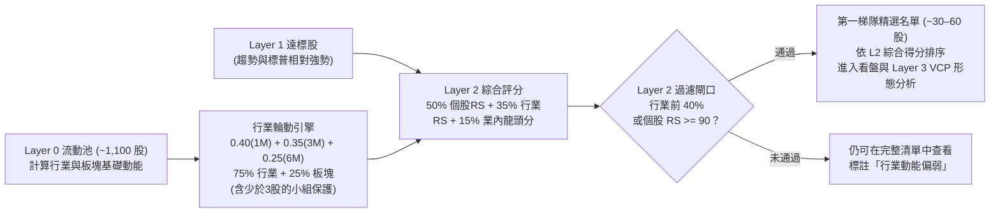

# Layer 2 專家小組討論與最優設計提案（繁體中文版）

**目標對象：** Bryan Ho  
**目標持倉週期：** 3–10 個交易日（短中期強勢突破 / 動能波段）· 4–8 隻高度集中持倉  
**系統定位：** 直接承接 **Layer 0**（流動性美股池）與 **Layer 1**（11 項趨勢與標普 500 動能過濾門檻）

---

## 1. 五人專家顧問團陣容

| 專家代表 | 核心專長與視角 | 對 Layer 2 的核心主張 |
| :--- | :--- | :--- |
| **1. 威廉·歐尼爾 (William O'Neil)** | CAN SLIM 創辦人、《IBD》創始人 | **「股票總是成群結隊（Stocks travel in packs）。」** 股價漲幅有 37% 來自所屬行業組（Industry Group），12% 來自所屬板塊（Sector）。絕不買身處弱勢行業的股票。 |
| **2. MarketSmith 架構師** | 197 個行業組排名與 RS 評級系統設計者 | 追求純量化、客觀且可複製的百分位排序（`1–99`），將個股多月 RS 與行業組表現完美融合。 |
| **3. 馬克·米奈爾維尼 (Mark Minervini)** | 兩屆全美投資大賽冠軍（SEPA 體系） | **只做龍頭領頭羊（行業前 1–3 名）**，拒絕落後補漲股；同時必須保留機制保護「孤狼型（Lone Wolf）」在板塊啟動前率先突圍的超級龍頭。 |
| **4. JLaw** | 2024 及 2025 連續兩年全美投資大賽百萬組冠軍 | **極致追求 3–10 天的戰術反應敏銳度。** 資金輪動極快，傳統 6 個月行業統計往往落後於當前 1–4 週的機構輪動，需快速聚焦於每日最有爆發力的 15–30 隻股票。 |
| **5. 量化對沖專家 (Dr. Quant / 挑戰者)** | 機構量化 PM，專門質疑與壓力測試 | **揪出所有統計盲點：** 樣本過小失真（只有 1–2 隻股票的行業）、6 個月回測滯後性、巨型權值股失真、Layer 1 指標重疊以及倖存者偏差。 |

---

## 2. Layer 2 五大核心爭論點與辯證

### 爭論一：行業分類粒度 —— 粗略的「板塊 Sector (~20)」vs 細緻的「行業組 Industry (~130)」
* **歐尼爾 & MarketSmith 主張：** 必須用細緻的 **`Industry`**（約 130 個 TradingView 細分行業，對標 IBD 的 197 行業）。寬泛的 `Sector`（如科技、醫療）太粗糙——半導體可能大漲 30%，但軟體卻在跌 15%。
* **⚡ 挑戰者質疑（小樣本陷阱）：**
  > 「在 Bryan 的 Layer 0 候選池（約 1,100 隻優質流動股）中，有約 35 個細分行業**僅包含 1 到 2 隻股票**！如果某個 1 隻股票的小行業大漲 50%，它就會排在全美第 1 名，但這根本沒有『群聚效應』，純粹是個股在自我評判！相反地，一隻業績爆雷跌停也會毀掉一個 2 隻股票的行業。」
* **共識最優解（貝葉斯平滑混合評分）：**
  1. 以細緻的 **`Industry`** 為主，同時結合 **`Sector`**，採用 **`75% 行業 + 25% 板塊`** 的加權模式（精準對應歐尼爾研究發現的 37% : 12% $\approx 3:1$ 比例）。
  2. **小樣本保護屏障：** 當某細分行業在池子中**少於 3 隻股票**時，自動平滑收縮並向其母板塊均值靠攏，防止單一極端股票造就虛假的「第 1 名強勢行業」。

---

### 爭論二：計算週期窗口 —— 純「6 個月」vs「輪動加權 (1M / 3M / 6M)」
* **MarketSmith 主張：** 依照傳統做法，純按 **6 個月報酬率 (`Perf.6M`)** 排名。
* **⚡ 挑戰者與 JLaw 質疑（滯後陷阱與流動性撤退）：**
  > **JLaw：**「Bryan 的持倉週期是 **3 到 10 個交易日**，不是 1 年！假設太陽能板塊在 5 個月前大漲了 80%，但在過去 4 週已經見頂暴跌 12%。如果用純 6 個月排名，太陽能依然會是『前 10 名強勢行業』——這會引誘 Bryan 在垂死的熱點中買入假突破，反而錯過剛在近 2–4 週發動輪動的軍工或網通龍頭！」
* **共識最優解（輪動加權行業動能）：**
  結合多週期加權，對近期的機構資金輪動給予最高權重，同時兼顧中期結構：
  $$\text{行業原始報酬} = 0.40 \times \text{Perf}_{1\text{M}} + 0.35 \times \text{Perf}_{3\text{M}} + 0.25 \times \text{Perf}_{6\text{M}}$$
  * **優勢：** 既能第一時間捕捉 1–3 個月的新興熱點，又能及時扣除近期動能耗盡、高檔做頭的舊板塊。

---

### 爭論三：行業組內均值計算方式 —— 市值加權 vs 去極值等權與寬度
* **MarketSmith 主張：** 市值加權指數。
* **⚡ 挑戰者質疑（巨頭偏頗與極端值扭曲）：**
  > 「市值加權會讓輝達（NVDA）一人佔據半導體行業 70% 權重，禮來（LLY）主導製藥。即使組內 20 隻晶片股有 18 隻跌破均線，輝達上漲就會讓整個行業看似極其健康。反之，純等權平均若遇到一隻小型生技股因 FDA 消息單日暴漲 250%，會虛構出整個板塊都在爆發的假象。」
* **共識最優解（去極值等權 + 板塊寬度）：**
  1. 對 Layer 0 候選池內的股票剔除前後 5% 極端離群值後計算等權均值。
  2. 加入**行業健康度/寬度指標（Group Breadth）**（例如：該行業內站上 50 日均線的股票比例），輔助判斷是全體齊漲還是單兵作戰。

---

### 爭論四：綜合評分公式 —— 避免重複計分與「弱股搭便車」
* **歐尼爾主張：** `50% 個股 RS + 50% 行業 RS`。
* **米奈爾維尼警告：** 「絕對不能因為某個行業第一名，就去買該行業排名第 8 的落後股！機構大資金永遠只會集中買入該板塊最強的前 1 至 3 名龍頭。」
* **⚡ 挑戰者質疑（變異數壓縮失衡）：**
  > 「通過 Layer 1 的股票已經全部通過了 `C8 (個股 RS ≥ 70)`，代表它們的 RS 都在 `70–99` 之間（僅 29 分差距）；然而行業百分位是 `1–99`（98 分差距）。如果直接各佔 50%，行業分數的實質影響力會變成個股的 3.4 倍，導致一個個股 RS 僅 71 的平庸股票，靠著熱門行業硬是爬到全榜榜首！」
* **共識最優解（三維標準化 Layer 2 綜合評分 `0–100`）：**
  1. **50% —— 個股相對強度評級 (`rs_percentile`, `1–99`)：** 牢牢鎖定強勢動能本質（RS 85–99）。
  2. **35% —— 板塊順風強度 (`group_rs_percentile`, `1–99`)：** `75% 行業 RS + 25% 板塊 RS`。
  3. **15% —— 行業內龍頭地位評分 (`leader_score`, `0–100`)：** 根據個股在同業中的內部排名給分（第 1 名給 100 分，第 2 名給 90 分，第 3 名給 80 分，隨後遞減）。落實米奈爾維尼與 JLaw「只做前三名強勢龍頭」的原則！

---

### 爭論五：行業前 30–40% 是否該作為「硬性剔除門檻」？
* **歐尼爾主張：** 硬性門檻 —— 凡是行業排名在後 60% 的一律淘汰。
* **⚡ 米奈爾維尼與挑戰者質疑（「孤狼超級龍頭」悖論）：**
  > **米奈爾維尼：**「在牛市轉折點或新技術浪潮誕生時，**真正的全市場總龍頭往往率先獨自發動**，甚至比同業其他股票早 3 到 6 個星期突破！如果採用一刀切的硬性前 40% 行業過濾，系統會在最具爆發力的暴利主升段開始前，把一隻 RS 98 的孤狼龍頭生生閹割掉！」
* **共識最優解（可開關前 40% 門檻 + 「超強龍頭豁免條款」）：**
  * **預設規則：** 保留**行業評分 $\ge 60$（全市場前 40% 強勢行業）**的股票，**或者**個股 **`RS Rating ≥ 90`（孤狼超強龍頭豁免，允許自帶動能突破）**。
  * 遵循系統一貫的透明原則：所有指標均計算並呈現，用戶隨時可一鍵切換查看完整 Layer 1 清單，絕不在黑盒子中刪除數據。

---

## 3. Layer 2 具體落地架構與 UI 配置

